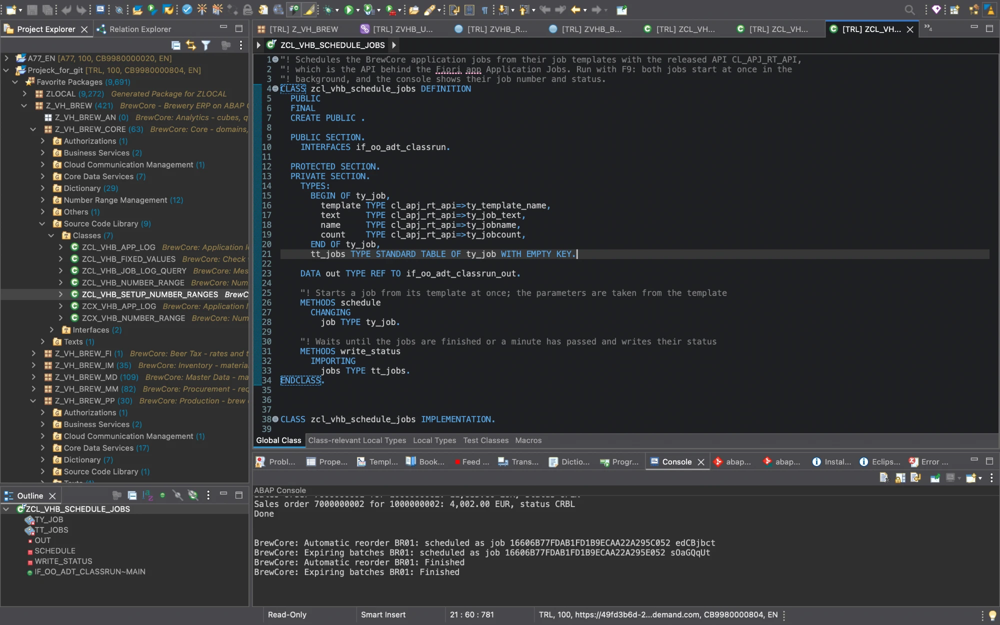
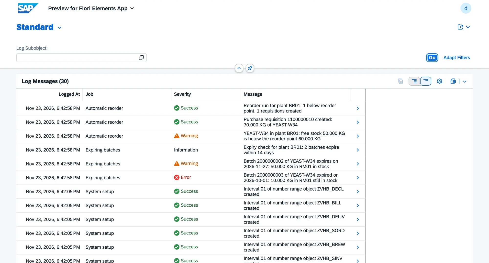
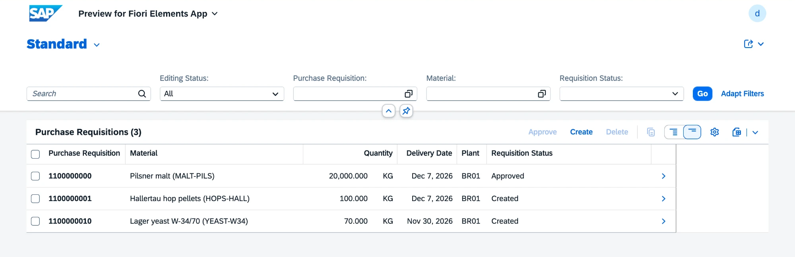

# v0.10 Automation

Two nightly application jobs: automatic reorder for raw materials below their reorder point, and a check for batches that expire soon. Both report to the application log, which is shown in a Job Logs app. Requirement FR-IM-05.

## What is inside

| Object | Behavior |
|---|---|
| Reorder job `ZCL_VHB_REORDER_JOB` | for every active purchased material of the plant with a reorder point: if free, unexpired stock is below it, a purchase requisition tops the stock up to twice the reorder point; delivery in 7 days |
| Protection against double orders | a material with an open requisition (New, Approved) or an open purchase order is only reported |
| Test run | parameter of the reorder job: the log shows what would be ordered, nothing is created |
| Expiry job `ZCL_VHB_BATCH_EXPIRY_JOB` | every batch with stock whose best-before date is within the next days (14 by default): warning; already expired with stock left: error |
| Job catalog entries and templates | `ZVHB_REORDER` with `ZVHB_REORDER_BR01` (plant BR01), `ZVHB_BATCH_EXPIRY` with `ZVHB_BATCH_EXPIRY_BR01` (BR01, 14 days) |
| Scheduler `ZCL_VHB_SCHEDULE_JOBS` | starts both templates as background jobs with `CL_APJ_RT_API` and prints job number and status |
| Application log | object `ZVHB_LOG`, subobjects `REORDER` and `BATCH_EXPIRY`, plant as external ID, assigned to the job |
| Job Logs app | `ZVHB_UI_JOBLOG_O4`: messages of the last 30 days with time, job, plant, severity and text, filter by subobject |

| Area | Objects |
|---|---|
| Table | `ZVHB_LOGMSG`, the copy of the log messages for the Job Logs app |
| Views | custom entity `ZVHB_C_JobLog` with query class `ZCL_VHB_JOB_LOG_QUERY` |
| App | `ZVHB_UI_JOBLOG` and `ZVHB_UI_JOBLOG_O4` |
| Logging | `ZCL_VHB_APP_LOG` stores every message also in `ZVHB_LOGMSG` and commits on save |
| Messages | `ZVHB_MM` 040 to 045, `ZVHB_IM` 019 to 022 |

## Why a Job Logs app of its own

On the BTP trial users get no business roles. The standard apps Application Jobs and Application Logs cannot be opened, and reading the application log through the released API needs authorization object `S_APPL_LOG` from a business role. The jobs therefore use the standard frameworks unchanged, but BrewCore schedules them with a console class and shows the messages from its own copy. See [ADR 12](../adr/0012-application-jobs-and-job-log.md).

## Decisions

- [ADR 12](../adr/0012-application-jobs-and-job-log.md) Nightly checks run as application jobs and report to the application log

## Quality

- ABAP Unit: 17 new tests, all green.
  - 6 in `ZCL_VHB_REORDER_JOB`: low stock proposed with quantity 2 × reorder point − free stock, enough stock skipped, expired stock not counted, open requisition and open order named, finished products not bought.
  - 5 in `ZCL_VHB_BATCH_EXPIRY_JOB`: batch within the horizon, later batch ignored, expired batch found, empty batch ignored, order by date.
  - 6 in `ZCL_VHB_JOB_LOG_QUERY`: job names, severity and criticality, messages older than 30 days hidden, filter by subobject.

  Materials, plant data, stock, requisitions, purchase orders and the log table are replaced by SQL test doubles. The tests of the application log stay green.
- ATC with check variant `ABAP_CLOUD_DEVELOPMENT_DEFAULT`: no errors and no warnings.
- abaplint: green on push.

## How to check

1. Run `ZCL_VHB_SCHEDULE_JOBS` with F9. The console shows both jobs scheduled and Finished.
2. In ADT open `Z_VH_BREW_CORE`, Business Services, Service Bindings, `ZVHB_UI_JOBLOG_O4`, entity set JobLogs, Preview, Go. The reorder run shows the yeast below the reorder point and the new requisition, the expiry run shows the batches that expire soon or have expired.
3. Open `ZVHB_UI_PURCHASEREQUISITION_O4`, entity set PurchaseRequisitions: the requisition of the job is there with status Created.
4. Run `ZCL_VHB_SCHEDULE_JOBS` again. The reorder job orders nothing and names the open requisition.

## Screenshots

Both jobs scheduled from their templates and finished.

The Job Logs app: what the reorder and the expiry job found and did.

Requisition 1100000010 for 70 kg yeast, created by the reorder job: 50 kg free, reorder point 60 kg.

## What I learned

- An application job is a class with two interfaces: one describes the parameters for the catalog entry, the other runs the job. The template only stores the values.
- `CL_APJ_RT_API` starts a job from a template, so the same job can be scheduled from code, from the app or from another job.
- A job may change business objects through EML and must commit with `COMMIT ENTITIES` itself, because it runs outside of a RAP transaction.
- The application log is written by every user, but reading it is an authorization of its own. Without a business role, the released read API reports "no log found".
- After an abapGit pull into an empty system, one object with an error can stop a mass activation of all others. Behavior definitions and number range objects were activated one by one.
