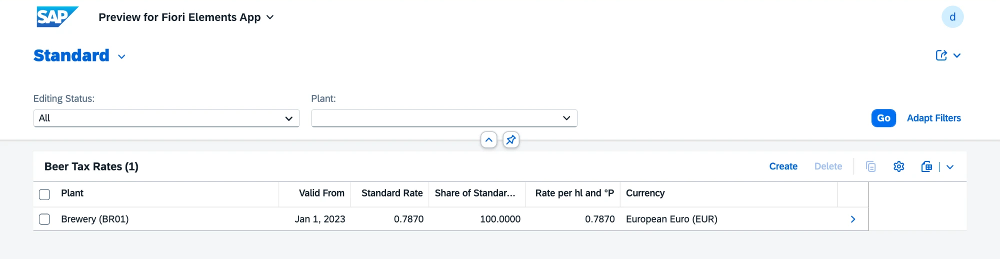
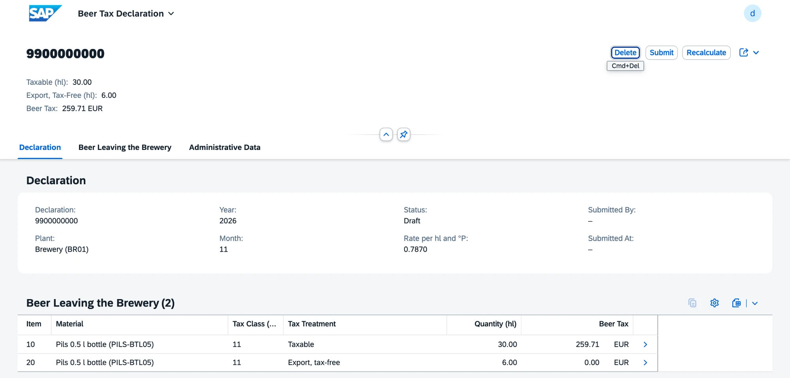
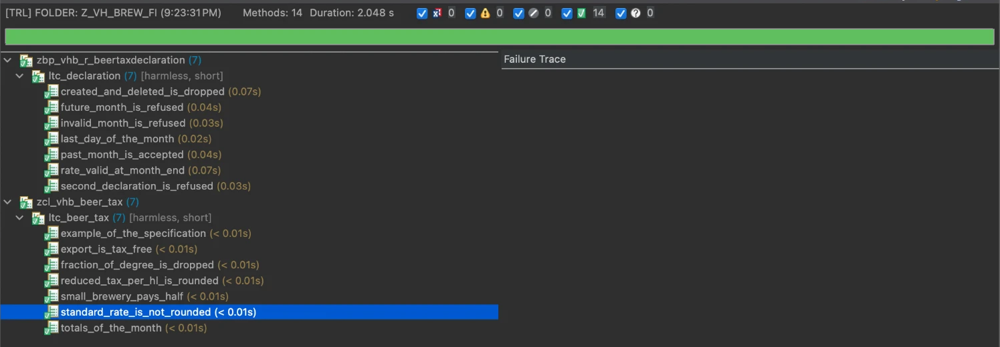
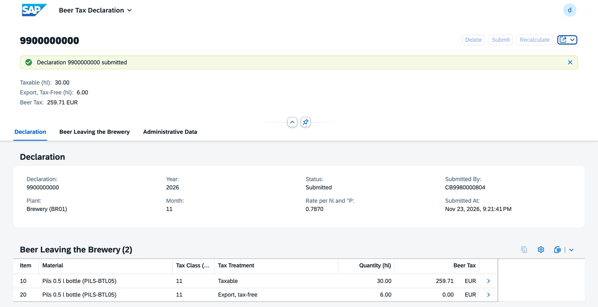

# v0.11 Beer tax

Monthly German beer tax declaration: rates per plant, the tax base from the goods issues of beer, export free of tax, and a declaration that is generated, recalculated and submitted. Requirements FR-FI-01 to FR-FI-03.

## What is inside

| Object | Behavior |
|---|---|
| Beer tax rate `ZVHB_R_BeerTaxRate` | plant, valid from, standard rate (0.787 EUR per hl and °P), share the plant pays (50 % to 100 %); rate per hl and °P calculated to four decimal places |
| Original extract | new field of the material: the original extract registered with customs, in °P |
| Tax base | `ZVHB_I_BeerTaxBaseItem`: delivery items of finished beer with posted goods issue (movement type 601), in hectoliters, in the month of the goods issue; customers outside Germany are export |
| Calculation | `ZCL_VHB_BEER_TAX`: tax class in whole degrees, rate, tax per hl, lines and totals of a month |
| Beer tax declaration `ZVHB_R_BeerTaxDeclaration` with items | unmanaged business object with its own transactional buffer and saver; number from `ZVHB_DECL` on save; status Draft or Submitted |
| Generate | static action: plant and month; refused for an invalid month, a month that has not started, a plant without rate or a month that is already declared |
| Recalculate | rebuilds the items of a draft from the current goods issues and rate |
| Submit | status Submitted with user and time; from then on the declaration is only read |

| Area | Objects |
|---|---|
| Domains | `ZVHB_DECL_STATUS` (DRFT, SUBM), `ZVHB_TAX_TREATMENT` (TAXD, EXPT) with value helps |
| Data elements | `ZVHB_DECL_STATUS`, `ZVHB_TAX_TREATMENT`, `ZVHB_TAX_DECLARATION` |
| Tables | `ZVHB_BTRATE` and its draft table, `ZVHB_BTDECL`, `ZVHB_BTDECLITM` |
| Lock object | `EZVHB_BTDECL` |
| Views | `ZVHB_I_BeerTaxBaseItem`, `ZVHB_I_BeerTaxBase`, `ZVHB_I_DeclStatusVH`, `ZVHB_I_TaxTreatmentVH` |
| Master data | material: `OriginalExtract` |
| App | `ZVHB_UI_BEERTAX_O4` with tax rates, declarations and declaration items |
| Messages | `ZVHB_FI` 001 to 005 and 010 to 018 |
| Demo data | `ZCL_VHB_DEMO_DATA` registers the Pils with 11.5 °P and 200 bottles per hl, creates the rate of BR01, sells 1,200 bottles to a wholesaler in Vienna and generates the declaration of the running month |

## Decisions

- [ADR 13](../adr/0013-beer-tax-declaration-unmanaged.md) Beer tax: rates per plant, base from goods issues, declaration as unmanaged business object

## Quality

- ABAP Unit: 14 new tests, all green.
  - 7 in `ZCL_VHB_BEER_TAX`: fraction of a degree dropped, the example of the specification (1,000 hl × 11 × 0.787 = 8,657 EUR), standard rate not rounded per hl, 50 % and 75 % of the standard rate, reduced tax per hl rounded, export free of tax, totals of a month.
  - 7 in `ZBP_VHB_R_BEERTAXDECLARATION`: invalid month, month not started, second declaration of a month, running month accepted, last day of a month incl. leap year, rate valid at month end, created and deleted declaration never reaches the database.

  Declarations and rates are replaced by SQL test doubles. The tests of material and sales order stay green.
- ATC with check variant `ABAP_CLOUD_DEVELOPMENT_DEFAULT`: no errors and no warnings in `Z_VH_BREW_FI`.
- abaplint: green on push.

## How to check

1. Run `ZCL_VHB_DEMO_DATA` with F9. The console ends with the declaration of the running month: 30.00 hl taxable, 6.00 hl export, tax 259.71 EUR.
2. In ADT open `Z_VH_BREW_FI`, Business Services, Service Bindings, `ZVHB_UI_BEERTAX_O4`. Entity set TaxRates, Preview, Go: BR01 pays 0.7870 EUR per hl and °P.
3. Entity set Declarations, Preview, Go, open the declaration: 6,000 bottles for the wholesaler in Munich are taxed, 1,200 bottles for Vienna are export.
4. Choose Submit. Delete, Submit and Recalculate are no longer possible.

## Screenshots

The rate of the brewery: standard rate of section 2 BierStG, valid from 2023.

Declaration of November 2026 as a draft: 30 hl × 11 × 0.787 = 259.71 EUR, the export line carries no tax.

The tests of the tariff and the declaration.

After Submit the declaration is read-only.

## What I learned

- In an unmanaged business object the framework calls the handlers and the saver, but keeping the changes is my job. A buffer that every read goes through makes the actions see their own changes before the save.
- A static factory action creates instances without a create operation; the new key goes back through MAPPED with the %cid of the request.
- `finalize` is the place for numbers: it runs once per save, before `save` writes and after all actions are done.
- Lock objects can be created in ABAP Cloud; `CL_ABAP_LOCK_OBJECT_FACTORY` sets the lock, and it is released at the end of the transaction.
- The text of the law is not always complete. When a rule is open, the configuration takes the value from the authority instead of the code guessing it.
