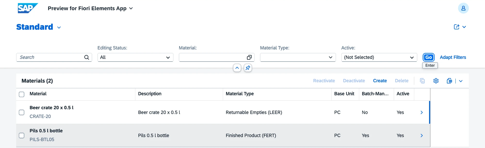
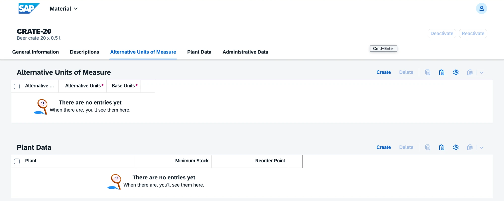
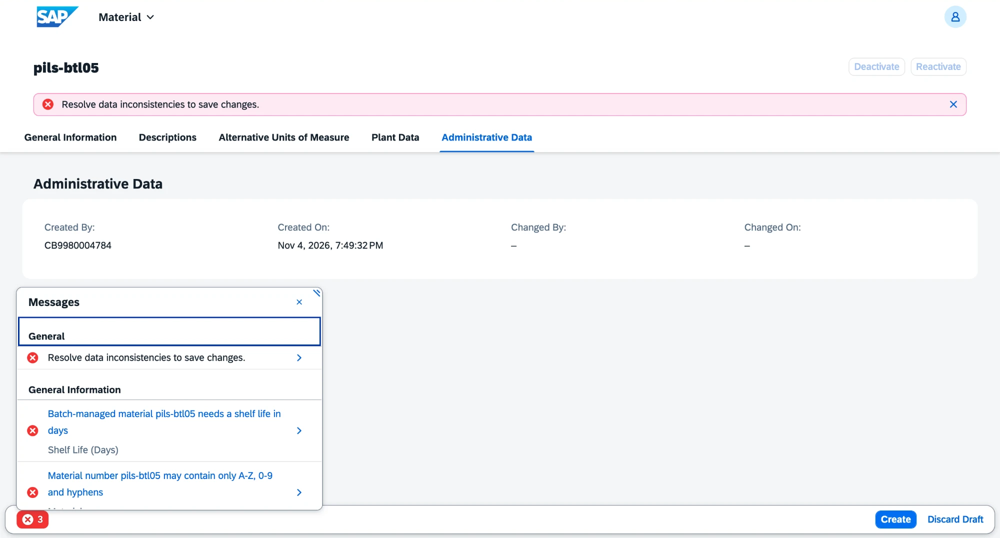
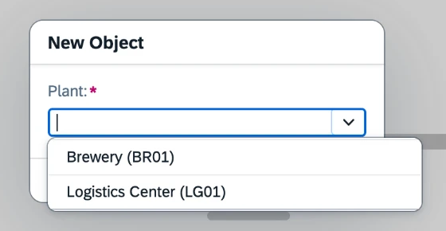
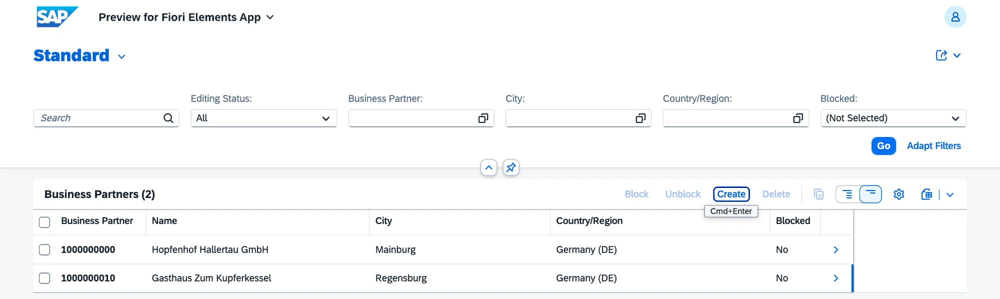
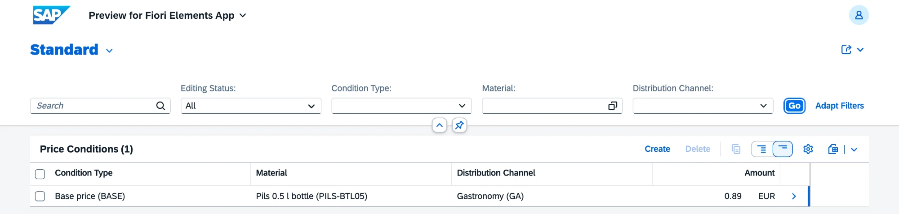

# v0.2 Master data

Three Fiori Elements apps with draft for the master data every later process needs: materials, business partners and price conditions. Requirements FR-MD-01, FR-MD-02 and FR-MD-05.

## What is inside

| Business object | Entities | Behavior |
|---|---|---|
| Material `ZVHB_R_Material` | material, descriptions per language, alternative units, plant data | actions Deactivate and Reactivate, batch management set from the material type, checks for material number format, units, conversion factors, plant and stock levels |
| Business partner `ZVHB_R_BusinessPartner` | partner, roles Supplier and Customer | partner number from `ZVHB_PARTN` on save, actions Block and Unblock, defaults EUR and 30 days net, checks for name, country, currency, payment terms, credit limit and at least one role |
| Price condition `ZVHB_R_PriceCondition` | condition, quantity scales | base price per material and distribution channel, deposit (Pfand) only for returnable empties and without channel or scales, check against overlapping validity |

Each business object is a managed RAP BO with draft and `strict ( 2 )`. It has its own projection, metadata extension, service definition and OData V4 UI service binding (`ZVHB_UI_MATERIAL_O4`, `ZVHB_UI_BUSINESSPARTNER_O4`, `ZVHB_UI_PRICECONDITION_O4`).

| Area | Objects |
|---|---|
| Domains with fixed values | `ZVHB_BP_ROLE` (SU, CU), `ZVHB_PAY_TERMS` (0001, NT14, NT30), `ZVHB_COND_TYPE` (BASE, DEPO) |
| Value helps | `ZVHB_I_MaterialVH`, `ZVHB_I_PartnerRoleVH`, `ZVHB_I_PaymentTermsVH`, `ZVHB_I_ConditionTypeVH`, plus the CORE value helps for plant, channel and material type; units, countries and currencies from the released views `I_UnitOfMeasureStdVH`, `I_Country` and `I_Currency` |
| Tables | 6 active tables and 6 draft tables |
| Messages | `ZVHB_MD` 001 to 031 |
| Base unit | `ZVHB_UNIT` now uses domain `MEINS`, so the internal unit `ST` is shown as `PC` |

## Decisions

- [ADR 4](../adr/0004-plant-authorization-in-v1.md) Authorization by plant comes with the roles in v1.0
- [ADR 5](../adr/0005-partner-number-on-save.md) UUID key with the partner number assigned on save
- [ADR 3](../adr/0003-domains-only-for-fixed-values.md) updated: how material numbers and fixed values are checked

## Quality

- ABAP Unit: 54 tests in the three behavior pools (material 20, business partner 15, price condition 19), all green. The tests run on the RAP transactional buffer double and the ABAP SQL test environment. Number assignment is replaced by a test double of `ZIF_VHB_NUMBER_RANGE`.
- ATC with check variant `ABAP_CLOUD_DEVELOPMENT_DEFAULT`: no errors and no warnings in 137 objects. The 6 remaining infos (priority 3) report read access to the released views `I_Country`, `I_Currency`, `I_UnitOfMeasure` and the domain value view.
- abaplint: green on push. The behavior pool includes skip `check_syntax`, `parser_error` and `keyword_case`, because abaplint does not know the implicit RAP handler parameters, the RAP test statements and the CamelCase entity names.

## How to check

1. Open the preview of `ZVHB_UI_MATERIAL_O4` and create material `CRATE-20`, type Returnable Empties, base unit PC. Batch management stays off.
2. Open the preview of `ZVHB_UI_BUSINESSPARTNER_O4`, create a partner and save it without a role: the save is rejected. Add role Supplier and save: the partner number appears.
3. Open the preview of `ZVHB_UI_PRICECONDITION_O4` and create a base price for `PILS-BTL05` in channel GA. A second base price for the same material and channel with overlapping validity is rejected.
4. Create a deposit for `CRATE-20`: the channel field is read-only and quantity discounts cannot be added.
5. Run ABAP Unit on package `Z_VH_BREW_MD`.

## Screenshots

Material list with a finished product and a returnable crate.

Material `CRATE-20` in draft. Deactivate and Reactivate stay disabled until the material is saved.

Validation messages on save.

Plant value help from the domain fixed values.

Business partners with numbers from the number range.

Price conditions with material and channel texts.

## What I learned

- Entity sets in the service definition get plural aliases. RAP names the OData entity type `<alias>Type`, and an alias `Material` clashes with the property `MaterialType`.
- Validations that read CDS views with access control need `WITH PRIVILEGED ACCESS`.
- Draft table field names must match the CDS element names, for example `distributionchannel` and not `distr_channel`.
- Field feature control together with a side effect makes a field read-only right after another field changes, without saving.
- Creating a draft in a unit test checks the key against the database, so tests use keys that no real record has.
