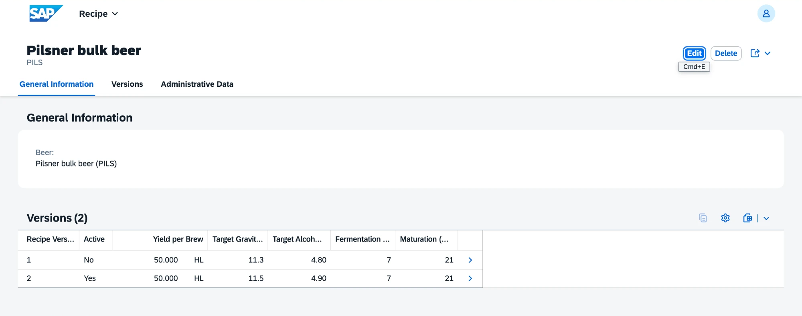
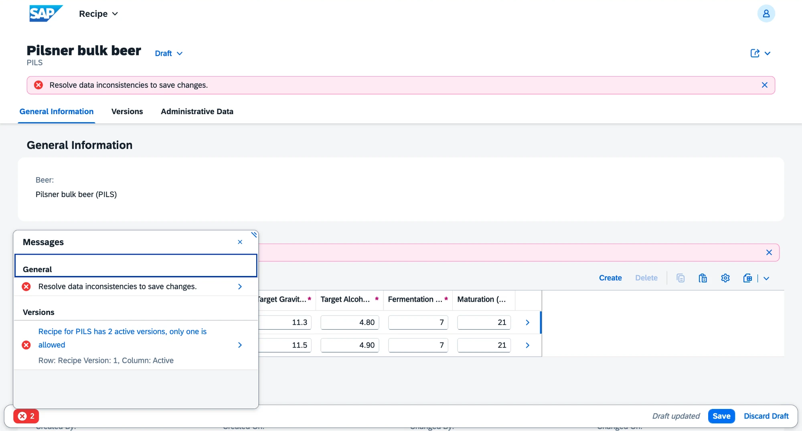
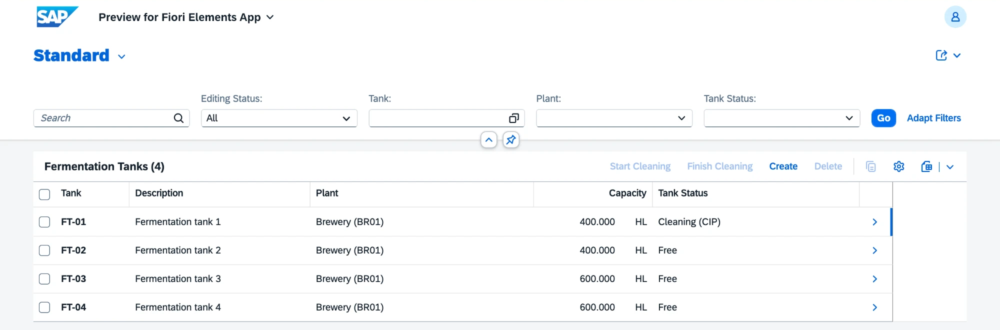

# v0.3 Recipes and fermentation tanks

Master data for production: brewing recipes with versions and components, and the fermentation tanks that later stages plan brews into. Requirements FR-MD-03 and FR-MD-04.

## What is inside

| Business object | Entities | Behavior |
|---|---|---|
| Recipe `ZVHB_R_Recipe` | recipe per beer, versions, components per brew | three-level composition with draft; version numbers 001, 002 ... assigned on creation; yield in hl, target gravity in °P, target alcohol, fermentation and maturation days; only one active version per recipe |
| Fermentation tank `ZVHB_R_FermentationTank` | tank | plant, capacity in hl, status Free, Occupied or Cleaning (CIP); actions Start Cleaning and Finish Cleaning on saved tanks; an occupied tank cannot be deleted |

Both are managed RAP business objects with draft and `strict ( 2 )`, each with an OData V4 UI service binding (`ZVHB_UI_RECIPE_O4`, `ZVHB_UI_FERMENTATIONTANK_O4`).

Checks on the recipe:

- Recipe: the beer exists, is active and is a finished product (FERT). Each beer has one recipe.
- Version: yield above zero, gravity between 1 and 30 °P, alcohol between 0 and 15 % vol, at least one day of fermentation.
- Version, across records: only one active version per recipe, and an active version needs at least one component.
- Component: an active raw material (ROH) with a quantity above zero, each material only once per version.

| Area | Objects |
|---|---|
| Domain | `ZVHB_TANK_STATUS` (FREE, BUSY, CIP) with value help `ZVHB_I_TankStatusVH` |
| Data elements | `ZVHB_TANK`, `ZVHB_TANK_STATUS`, `ZVHB_RECIPE_VERSION`, `ZVHB_DAYS` |
| Tables | `ZVHB_RECIPE`, `ZVHB_RCPVER`, `ZVHB_RCPCOMP`, `ZVHB_FTANK` and their draft tables |
| Value helps | the component and recipe material value helps are filtered to ROH and FERT |
| Messages | `ZVHB_MD` 032 to 045 |

## Quality

- ABAP Unit: 27 new tests (recipe 19, tank 8), 81 in package `Z_VH_BREW_MD`, all green.
- ATC with check variant `ABAP_CLOUD_DEVELOPMENT_DEFAULT`: no errors and no warnings in 180 objects. The new behavior pools have no findings at all.
- abaplint: green on push.

## How to check

1. Run `ZCL_VHB_DEMO_DATA` with F9. It creates the bulk beer `PILS`, malt, hops and yeast, the Pils recipe with version 001 and the active version 002, and the tanks `FT-01` to `FT-04`.
2. Open the preview of `ZVHB_UI_RECIPE_O4` and the recipe for `PILS`. Mark version 001 active as well and save: the save is rejected because only one version may be active.
3. Open the preview of `ZVHB_UI_FERMENTATIONTANK_O4`, select `FT-01`, then Start Cleaning and Finish Cleaning.
4. Run ABAP Unit on package `Z_VH_BREW_MD`.

## Demo data

`ZCL_VHB_DEMO_DATA` in the superpackage fills a fresh system with the master data of Nordhopf Brauerei: six materials, four business partners, three price conditions, the Pils recipe and four fermentation tanks. It writes through EML, so every record passes the same validations as in the Fiori apps, and it skips records that already exist.

## Screenshots

Recipe with its versions.

Second active version rejected on save.

Fermentation tanks with their status.

## What I learned

- A third composition level needs `lock dependent by` and `authorization dependent by` on the root association, so the grandchild carries the root key as part of its own key.
- Rules that span several records, such as one active version, read all siblings through the parent with `READ ENTITIES ... BY \_Version`, because the validation only receives the changed instances.
- Version numbers are assigned in a determination on create by taking the highest number among the siblings, including the drafts in the same request.
- Calculated fields such as a status criticality cannot be added in a transactional projection. They belong in the base view, and with draft also in the draft table.
- A table cannot have the same name as an existing data element. The tank table is called `ZVHB_FTANK` for that reason.
