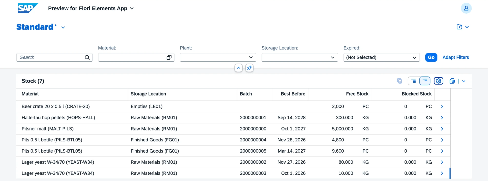
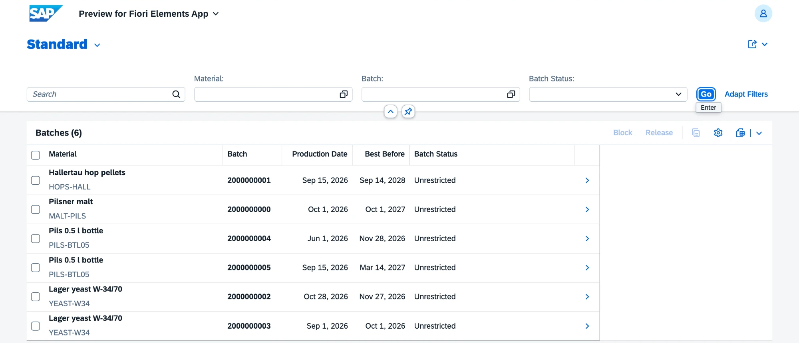
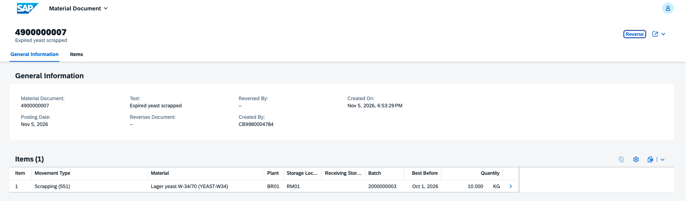
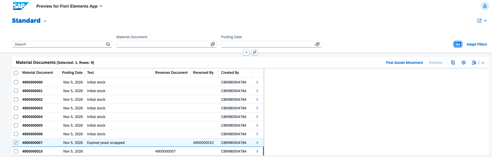

# v0.4 Inventory and batches

Material documents, batches with best-before dates and stock that is calculated from the documents. Requirements FR-IM-01 to FR-IM-04.

## What is inside

| Object | Behavior |
|---|---|
| Material document `ZVHB_R_MaterialDocument` | append-only: posted with the action Post Goods Movement, corrected only with Reverse; number assigned on save (late numbering); movement types 101, 261, 311, 551, 561, 601 and their reversals 102 to 602 |
| Batch `ZVHB_R_Batch` | created by goods receipts; production date and best-before date (production date + shelf life); status Unrestricted or Blocked with the actions Block and Release |
| Stock `ZVHB_I_Stock` | sum of all movements per material, plant, storage location and batch; free and blocked stock; remaining shelf life and an expiry flag |
| FEFO `ZVHB_I_FefoBatch` | batches that may be issued, earliest best-before date first |

Checks when posting:

- movement type, material (exists and active), plant, storage location and quantity;
- batch-managed materials need a batch for issues and scrapping; receipts without a batch create a new one;
- an issue without a batch gets the FEFO batch; expired batches cannot be issued, only scrapped;
- an issue cannot take more than the free stock; scrapping may also take blocked stock;
- a transfer posting needs a different receiving storage location;
- a document is reversed once, a reversal cannot be reversed, and a receipt whose stock is already used cannot be reversed.

| Area | Objects |
|---|---|
| Domains | `ZVHB_MOVEMENT_TYPE`, `ZVHB_BATCH_STATUS` in CORE with value helps |
| Data elements | `ZVHB_MATDOC`, `ZVHB_MATDOC_ITEM`, `ZVHB_MOVEMENT_TYPE`, `ZVHB_BATCH_STATUS` in CORE |
| Tables | `ZVHB_MDOCHDR`, `ZVHB_MDOCITM`, `ZVHB_BATCHES` |
| Apps | `ZVHB_UI_MATERIALDOCUMENT_O4` (material documents), `ZVHB_UI_STOCK_O4` (stock overview and batches) |
| Messages | `ZVHB_IM` 001 to 018 |
| Demo data | `ZCL_VHB_DEMO_DATA` posts the initial stock (movement type 561) |

## Decisions

- [ADR 6](../adr/0006-material-document-journal.md) The material document is an append-only journal

## Quality

- ABAP Unit: 25 new tests (material document 20, batch 5), all green. The posting tests replace the material, batch and stock views with SQL test doubles.
- ATC with check variant `ABAP_CLOUD_DEVELOPMENT_DEFAULT`: no errors and no warnings.
- abaplint: green on push.

## How to check

1. Run `ZCL_VHB_DEMO_DATA` with F9. It posts the initial stock: malt, hops, two yeast batches (one already expired), two Pils batches with different best-before dates and crates.
2. Open the preview of `ZVHB_UI_STOCK_O4`, entity Stock Overview: free stock per batch, the expired yeast batch is flagged.
3. Open the preview of `ZVHB_UI_MATERIALDOCUMENT_O4` and post movement type 551 for the expired yeast batch: the stock goes down.
4. Reverse the scrapping document: a 552 document is created and the stock is back. The original document has no Edit or Delete.

## Screenshots

Stock overview with free and blocked stock and best-before dates.

Batches with production and best-before dates.

Scrapping of the expired yeast batch.

Journal after the reversal: document 4900000010 reverses the scrapping 4900000007, and Reverse is no longer available for it.

## What I learned

- Managed with unmanaged save does not allow a persistent table; reads go through the CDS view and `save_modified` writes the tables.
- Late numbering: `adjust_numbers` gets the preliminary IDs; child items find their document through `READ ENTITIES ... BY \_MaterialDocument ... LINK` with `%key = %tmp`.
- Static factory actions create instances without a key from the caller and return them through `mapped` with `%cid` and `%pid`.
- CDS view entities support `union all`, `group by` with `having` and date functions such as `dats_days_between`, so stock and FEFO need no ABAP loops.
- Several names were taken: a table cannot be called like a data element, so the header table is `ZVHB_MDOCHDR`.
