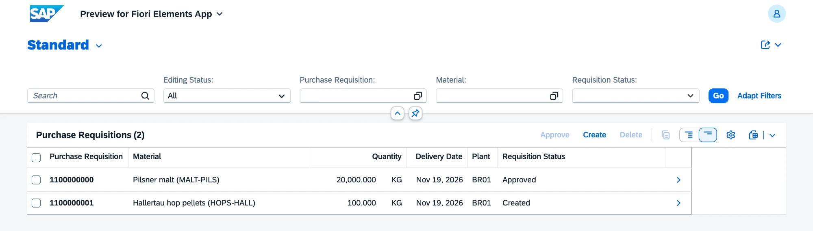
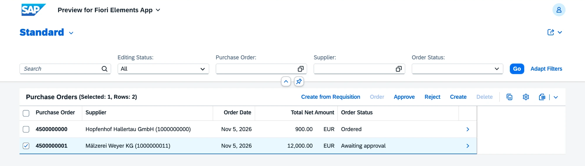
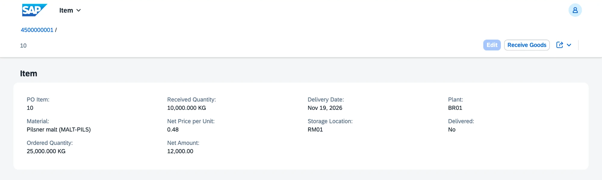

# v0.5 Procurement

Purchase requisitions, purchase orders with an approval step and goods receipts against the order. Requirements FR-MM-01 to FR-MM-04.

## What is inside

| Object | Behavior |
|---|---|
| Purchase requisition `ZVHB_R_PurchaseRequisition` | material, quantity, delivery date and an optional preferred supplier; number from `ZVHB_PREQ` on save; status Created, Approved or Ordered; action Approve; only a new requisition can be changed |
| Purchase order `ZVHB_R_PurchaseOrder` with items | supplier with its payment terms and currency, items numbered 00010, 00020 ...; net amount per item and total per order; number from `ZVHB_PORD` on save |
| Approval | Order sends the purchase order out; above 10,000 EUR it waits for Approve or Reject first |
| Create from Requisition | static factory action: an approved requisition, a supplier and a net price give a new purchase order, and the requisition becomes Ordered |
| Receive Goods | action on the order item: posts movement type 101 in inventory with the order reference and creates the batch |
| Goods receipt event | inventory raises `GoodsReceiptPosted`; the handler `ZCL_VHB_PO_GOODS_RECEIPT` raises the received quantity of the item and completes the order when everything has arrived |

Checks:

- requisition and order item: an active material that is not a finished product, quantity above zero, plant and storage location exist, delivery date not in the past;
- supplier: exists, has the supplier role and is not blocked;
- order: at least one item before it is ordered; currency exists;
- goods receipt: the order is ordered, the quantity is above zero and not above the open quantity.

| Area | Objects |
|---|---|
| Domains | `ZVHB_PR_STATUS` (NEW, APPR, ORDR), `ZVHB_PO_STATUS` (NEW, WAIT, ORDR, REJ, DONE) with value helps |
| Data elements | `ZVHB_PURCH_ORDER`, `ZVHB_PO_ITEM` in CORE; `ZVHB_PURCH_REQ`, `ZVHB_PR_STATUS`, `ZVHB_PO_STATUS` in MM |
| Tables | `ZVHB_PREQ`, `ZVHB_POHDR`, `ZVHB_POITM` and their draft tables; the material document item now carries the order reference |
| Value helps | `ZVHB_I_SupplierVH` (partners with the supplier role), `ZVHB_I_ApprovedRequisitionVH` |
| Shared checks | `ZCL_VHB_PURCHASING_CHECK` for material, supplier and location |
| Apps | `ZVHB_UI_PURCHASEREQUISITION_O4`, `ZVHB_UI_PURCHASEORDER_O4` |
| Messages | `ZVHB_MM` 001 to 020 |
| Demo data | `ZCL_VHB_DEMO_DATA` creates two requisitions and two purchase orders: hops for 900 EUR (ordered) and malt for 12,000 EUR (awaiting approval) |

## Decisions

- [ADR 7](../adr/0007-goods-receipt-event.md) Purchasing learns about goods receipts from a business event

## Quality

- ABAP Unit: 39 new tests (purchase order 18, purchasing checks 12, purchase requisition 9), all green.
- ATC with check variant `ABAP_CLOUD_DEVELOPMENT_DEFAULT`: no errors and no warnings in 46 objects of `Z_VH_BREW_MM`. The 6 infos (priority 3) report EML in loops over several selected orders, a `SELECT SINGLE` by order number and item, read access to `I_Currency` and the event handler not reading `FAILED`.
- abaplint: green on push.

## How to check

1. Run `ZCL_VHB_DEMO_DATA` with F9.
2. Open the preview of `ZVHB_UI_PURCHASEREQUISITION_O4`: the malt requisition is approved, the hops requisition is new.
3. Open the preview of `ZVHB_UI_PURCHASEORDER_O4`. The malt order is above the approval limit and waits for approval. Select it and choose Approve.
4. Open the malt order, select item 00010 and choose Receive Goods with 10,000 kg.
5. Refresh the page: the received quantity is 10,000 kg, the order stays Ordered until the rest arrives. The new batch is in the stock overview of `ZVHB_UI_STOCK_O4`.

## Screenshots

Purchase requisitions with their status.

The malt order above 10,000 EUR waits for approval.

Order item after the goods receipt: 10,000 of 25,000 kg received.

## What I learned

- A RAP business event is declared in the behavior definition with a parameter entity and raised in the saver with `RAISE ENTITY EVENT`. Only the saver may raise it.
- The consumer is a global class `FOR EVENTS OF` with a local handler class that inherits from `cl_abap_behavior_event_handler`. It runs after the commit in its own transaction, opened with `cl_abap_tx=>modify( )` and closed with `cl_abap_tx=>save( )`.
- Action parameters come from abstract entities. A static factory action creates an instance without a key from the caller and returns it through `mapped`; with draft it can create an active instance directly.
- Inline declarations on quantity times price give a packed number without decimals. The result needs an explicit type, for example `CONV zvhb_amount( ... )`.
- A child entity with its own actions needs its own global authorization method.
