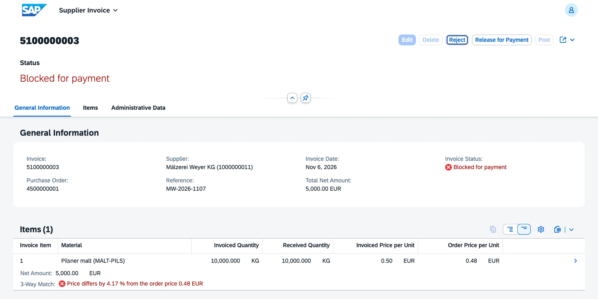
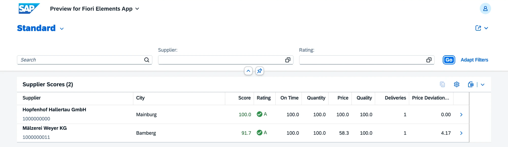

# v0.6 Invoice verification and supplier rating

Supplier invoices checked against the purchase order and the goods receipt (3-way match), and a supplier score from 0 to 100. Requirements FR-MM-05 and FR-MM-06.

## What is inside

| Object | Behavior |
|---|---|
| Supplier invoice `ZVHB_R_SupplierInvoice` with items | number from `ZVHB_SINV` on save; the purchase order proposes the items: received but not yet invoiced quantity at the order price; status Created, Blocked for payment, Posted or Rejected |
| Post | runs the 3-way match: a price deviation above 2 % or more quantity than received blocks the invoice, otherwise it is posted |
| Release for Payment, Reject | the manual decision on a blocked invoice |
| Match hint | virtual element per item, for example "Price differs by 4.17 % from the order price 0.48 EUR", red or green, already while the invoice is a draft |
| Supplier score `ZVHB_C_SupplierScore` | 0 to 100 per supplier: on time 40 %, quantity deviation 30 %, price deviation 20 %, quality 10 %; rating A from 80, B from 60, C below |

Checks on the invoice:

- the purchase order exists and was sent to the supplier (ordered or completed);
- the invoice number of the supplier is filled and not entered twice for the same supplier;
- the invoice date is not in the future;
- quantity and price of each item are above zero, in the currency of the invoice.

The score criteria:

- on time: share of order items whose first goods receipt came on or before the delivery date;
- quantity: average deviation between received and ordered quantity of complete or overdue items, one point per percent;
- price: average price deviation of posted and blocked invoices, ten points per percent;
- quality: 100 until inspection results come with quality management in v0.8.

| Area | Objects |
|---|---|
| Domain | `ZVHB_INV_STATUS` (NEW, BLCK, POST, REJ) with value help |
| Data elements | `ZVHB_SUPPL_INVOICE`, `ZVHB_INV_ITEM`, `ZVHB_INV_REFERENCE`, `ZVHB_INV_STATUS`, `ZVHB_SCORE` |
| Tables | `ZVHB_SINVHDR`, `ZVHB_SINVITM` and their draft tables |
| 3-way match | `ZVHB_I_PurchaseOrderHistory`, `ZVHB_I_InvoicedQuantity`, `ZVHB_I_InvoiceItemFigures`, `ZVHB_I_SupplierInvoiceMatch` |
| Supplier score | `ZVHB_I_SupplierDelivery`, `ZVHB_I_SupplierDeliveryKPI`, `ZVHB_I_SupplierPriceKPI`, `ZVHB_I_SupplierRating`, `ZVHB_I_SupplierScore`, `ZVHB_C_SupplierScore` |
| Apps | `ZVHB_UI_SUPPLIERINVOICE_O4` (supplier invoices), `ZVHB_UI_SUPPLIERSCORE_O4` (supplier scores) |
| Messages | `ZVHB_MM` 021 to 039 |
| Demo data | `ZCL_VHB_DEMO_DATA` receives the goods of both orders and enters two invoices: hops at the order price (posted) and malt at 0.50 instead of 0.48 EUR per kg (blocked) |

Fixed on the way: purchase order items created together with their header in one request got no currency. They now fall back to EUR, and the invoice takes the currency of the order header.

## Decisions

- [ADR 8](../adr/0008-three-way-match-in-cds.md) The 3-way match is calculated in CDS

## Quality

- ABAP Unit: 17 new tests (supplier invoice 13, match hint 4), 56 in package `Z_VH_BREW_MM`, all green. The invoice tests replace the purchase order data, the order history and the match view with SQL test doubles.
- ATC with check variant `ABAP_CLOUD_DEVELOPMENT_DEFAULT`: no errors and no warnings in `Z_VH_BREW_MM`.
- abaplint: green on push.

## How to check

1. Run `ZCL_VHB_DEMO_DATA` with F9. The console ends with one posted and one blocked invoice.
2. Open the preview of `ZVHB_UI_SUPPLIERINVOICE_O4` and the malt invoice: the status is Blocked for payment, the item shows the price deviation in red.
3. Choose Release for Payment: the invoice is posted.
4. Create an invoice for the hops order: no items are proposed, because the received quantity is already invoiced, and the save is rejected.
5. Open the preview of `ZVHB_UI_SUPPLIERSCORE_O4`: the maltings scores lower on price.

## Screenshots

Malt invoice blocked by the 3-way match: 0.50 EUR invoiced against 0.48 EUR ordered.

Supplier scores with the four criteria. The maltings loses 41.7 of 100 price points for 4.17 % price deviation: (100 × 4 + 100 × 3 + 58.3 × 2 + 100) / 10 = 91.7.

## What I learned

- CDS view entities calculate percentages with `division( a, b, decimals )`, replace missing values from outer joins with `coalesce` and need a second view whenever a calculated field is used in another calculation.
- Aggregates over calculated fields work in a view on top: `sum( case ... )` gives the quantity deviation only of the items that are due.
- A virtual element is a class with `if_sadl_exit_calc_element_read`. It gets the rows the app reads, drafts included, and fills the fields that SADL asks for.
- Inline declarations of numeric functions lose the decimals: `DATA(x) = abs( p )` is an integer. Messages with decimal values need a string template.
- A validation may not read the CDS view of another business object without privileged access; it reads the table instead.
- `DELETE itab WHERE` cannot compare two components of the same line.
