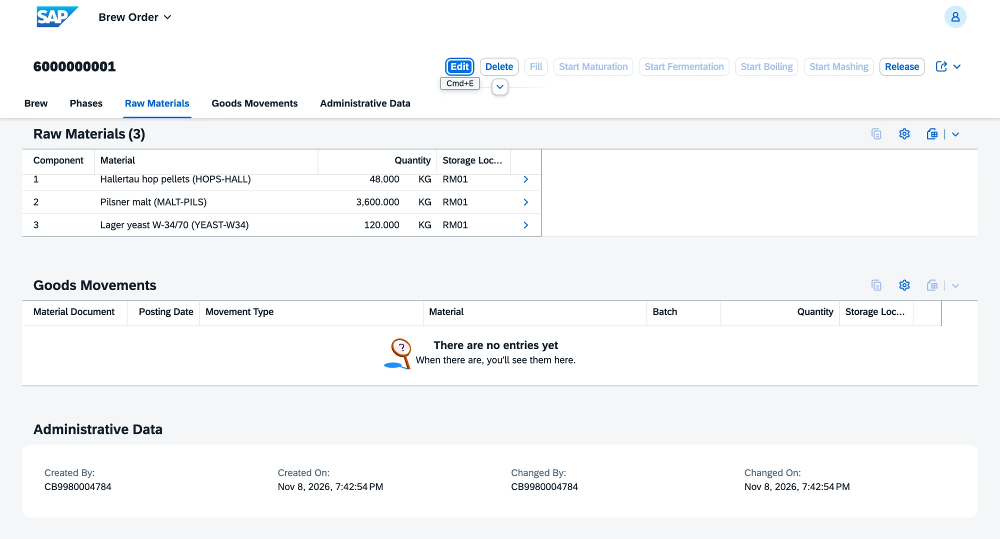
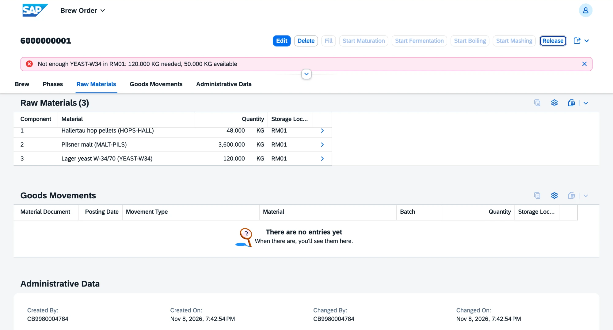

# v0.7 Production

Brew orders that copy the active recipe, check raw materials and the tank on release, run through the brewing phases and post the goods movements in inventory. Requirements FR-PP-01 to FR-PP-04.

## What is inside

| Object | Behavior |
|---|---|
| Brew order `ZVHB_R_BrewOrder` with components | beer, planned quantity, fermentation tank and planned start; number from `ZVHB_BREW` on save; the tank is planned until the start plus the fermentation and maturation days of the recipe |
| Recipe copy | choosing the beer copies the active recipe version and its components, scaled from the yield of one brew to the planned quantity; a new quantity scales them again |
| Release | checks raw materials and tank; the order can then no longer be changed |
| Start Mashing | goods issue with movement type 261 for every component; inventory picks the batches by FEFO |
| Start Boiling, Start Maturation | record the phase and its date |
| Start Fermentation | the tank must be free; it becomes occupied |
| Fill | goods receipt of the beer with movement type 101 into a new batch; the tank goes to cleaning (CIP) |
| Goods movements and beer batch | shown on the order from the material documents that carry the brew order number |

Status flow: Created, Released, Mashing, Boiling, Fermentation, Maturation, Filled. Each action is only enabled in the phase before it.

Checks on the brew order:

- the beer has an active recipe;
- the planned quantity is above zero and fits into the tank;
- the tank exists and belongs to the plant of the order;
- the planned start is not in the past;
- there is at least one component, each with a quantity above zero and an active raw material.

Checks on release:

- raw materials: per material and storage location, the components need no more than the free, unexpired stock minus the components of other released orders that are not mashed yet;
- tank: no other released or running brew in the same tank overlaps the planned period.

| Area | Objects |
|---|---|
| Domain | `ZVHB_BREW_STATUS` (NEW, REL, MASH, BOIL, FERM, MATU, DONE) with value help |
| Data elements | `ZVHB_BREW_ORDER` in CORE; `ZVHB_BREW_STATUS`, `ZVHB_BREW_COMP` in PP |
| Tables | `ZVHB_BREWHDR`, `ZVHB_BREWCMP` and their draft tables; the material document item now carries the brew order number |
| Views | `ZVHB_I_BeerRecipeVH` (beers with an active recipe), `ZVHB_I_TankVH`, `ZVHB_I_AvailableStock`, `ZVHB_I_OpenRequirement`, `ZVHB_I_BrewOrderBatch`, `ZVHB_C_BrewOrderMovement` |
| Fermentation tank | internal actions `occupy` and `empty`, not exposed in the tank app |
| App | `ZVHB_UI_BREWORDER_O4` (brew orders) |
| Messages | `ZVHB_PP` 001 to 020 |
| Demo data | `ZCL_VHB_DEMO_DATA` creates two Pils brews: 50 hl in FT-01 run up to fermentation, 200 hl in FT-02 stay new; a tank left in cleaning by an earlier run is cleaned first |

## Decisions

- [ADR 9](../adr/0009-brew-order-orchestrates-in-one-luw.md) The brew order drives inventory and the tank in one transaction

## Quality

- ABAP Unit: 16 new tests in `ZBP_VHB_R_BREWORDER`, all green. They cover the recipe copy and scaling, the validations, both release checks with open requirements and tank overlap, and the order of the phases. The transactional buffer and the recipe, tank, stock and order data are replaced by test doubles. The tests of inventory, the tank and purchasing stay green.
- ATC with check variant `ABAP_CLOUD_DEVELOPMENT_DEFAULT`: no errors and no warnings in `Z_VH_BREW_PP` and the changed classes of inventory and master data.
- abaplint: green on push.

## How to check

1. Run `ZCL_VHB_DEMO_DATA` with F9. The console ends with the 50 hl brew in status FERM and the 200 hl brew in status NEW.
2. Open the preview of `ZVHB_UI_BREWORDER_O4` and the 200 hl brew: the components are scaled from the recipe, 3,600 kg malt, 48 kg hops and 120 kg yeast.
3. Choose Release: it fails, because only 50 kg yeast are free.
4. Open the 50 hl brew: mashing, boiling and fermentation have their dates, the goods movements show the goods issue of the raw materials.
5. Choose Start Maturation, then Fill with 48 hl. The status is Filled, the new beer batch is on the order and tank FT-01 is in cleaning.

## Screenshots

Brew order of 200 hl with the components scaled from the recipe for 50 hl.

Release blocked: the yeast is not enough.

## What I learned

- An action can call other business objects through EML. All changes end up in one transactional buffer and are saved together, so a failed goods issue also stops the phase.
- Two periods overlap when each one starts before the other ends. In SQL this is two conditions, `start <= other end AND end >= other start`, and it covers all cases of partial and full overlap.
- A determination that creates child instances runs `IN LOCAL MODE`, otherwise the child create is checked against the features of the parent.
- Read-only fields cannot be set through EML in a test. The test calls the private method of the handler, which the test class may use as a friend.
- abaplint cannot follow association paths in CDS types used by ABAP. An explicit join gives the same field and keeps the static check working.
