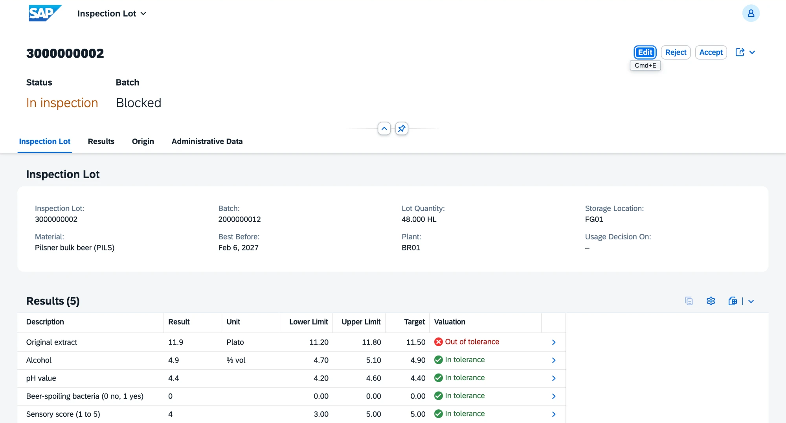
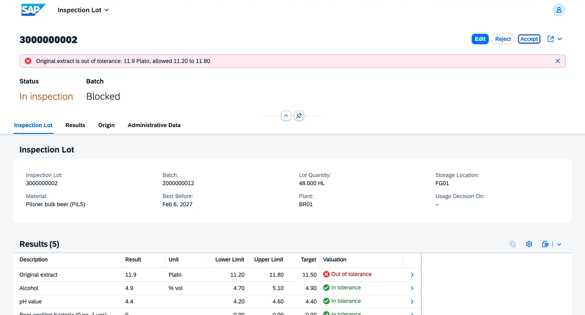
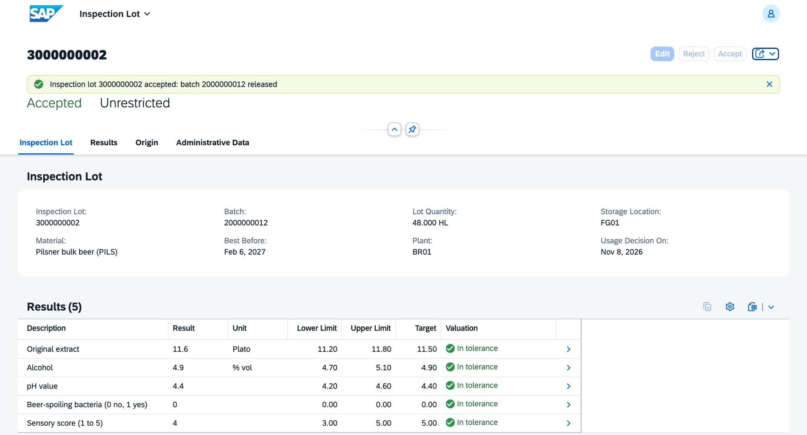

# v0.8 Quality

Inspection lots for new beer batches and for raw materials from new suppliers, results checked against tolerances, and a usage decision that releases or blocks the batch. Requirements FR-QM-01 to FR-QM-04.

## What is inside

| Object | Behavior |
|---|---|
| Inspection lot `ZVHB_R_InspectionLot` with characteristics | opened from the goods receipt event; number from `ZVHB_INSP` on save; origin Goods receipt from production or Goods receipt from purchase order; status In inspection, Accepted or Rejected |
| Opening a lot | every new beer batch; a raw material until the supplier has one accepted lot of that material; one lot per batch; the batch is blocked until the decision |
| Characteristics of beer | original extract and alcohol within ±0.3 °P and ±0.2 % vol of the recipe targets, pH 4.2 to 4.6, beer-spoiling bacteria (0 no, 1 yes), sensory score 1 to 5 with at least 3 |
| Characteristics of raw materials | contamination (0 no, 1 yes) and appearance and aroma (1 to 5) |
| Valuation | In tolerance, Out of tolerance or Not recorded per characteristic, shown while the results are entered |
| Accept | only when every characteristic is recorded and in tolerance; the batch becomes unrestricted |
| Reject | the batch stays blocked and its stock is scrapped with movement type 551 |
| Supplier score | the quality criterion is now the share of accepted raw material lots of the supplier |

Checks on the results:

- the result is a number, with a decimal point or a comma;
- microbiology is 0 or 1;
- the sensory score is a whole number from 1 to 5.

| Area | Objects |
|---|---|
| Domains | `ZVHB_LOT_STATUS` (OPEN, ACC, REJ), `ZVHB_LOT_ORIGIN` (01, 04) with value helps |
| Data elements | `ZVHB_INSP_LOT`, `ZVHB_LOT_STATUS`, `ZVHB_LOT_ORIGIN`, `ZVHB_INSP_CHAR`, `ZVHB_CHAR_RESULT`, `ZVHB_CHAR_VALUE`, `ZVHB_CHAR_UNIT` |
| Tables | `ZVHB_INSPLOT`, `ZVHB_INSPCHAR` and their draft tables |
| Event handler | `ZCL_VHB_QM_GOODS_RECEIPT` for `GoodsReceiptPosted` of the material document |
| Rules | `ZCL_VHB_CHARACTERISTIC_CHECK`: plausibility, valuation and virtual elements |
| Supplier score | `ZVHB_I_SupplierQualityKPI`, used by `ZVHB_I_SupplierRating` |
| Inventory | `GoodsReceiptPosted` is now also raised for receipts from a brew order and carries plant, storage location and unit |
| App | `ZVHB_UI_INSPECTIONLOT_O4` (inspection lots) |
| Messages | `ZVHB_QM` 001 to 012 |
| Demo data | `ZCL_VHB_DEMO_DATA` opens lots for receipts posted before this stage, accepts the malt, rejects the hops for contamination and leaves the beer lot open with an extract above the tolerance |

## Decisions

- [ADR 10](../adr/0010-inspection-lot-from-goods-receipt-event.md) Inspection lots are opened from the goods receipt event

## Quality

- ABAP Unit: 18 new tests, all green. 13 in `ZBP_VHB_R_INSPECTIONLOT` cover opening lots for beer and raw materials, one lot per batch, the approved supplier, the limits from the recipe, the plausibility checks, accept with missing and out-of-tolerance results, reject and the locked lot after the decision. 5 in `ZCL_VHB_CHARACTERISTIC_CHECK` cover the limits, the decimal comma and the findings. The buffers of the lot and the batch and the tables of brew orders, recipes, purchase orders, lots and stock are replaced by test doubles. The tests of inventory stay green.
- ATC with check variant `ABAP_CLOUD_DEVELOPMENT_DEFAULT`: no errors and no warnings in `Z_VH_BREW_QM`, the changed classes of inventory and the demo class.
- abaplint: green on push.

## How to check

1. Run `ZCL_VHB_DEMO_DATA` with F9. The console shows three lots: malt accepted, hops rejected with the scrapped quantity, beer with results recorded.
2. Open the preview of `ZVHB_UI_INSPECTIONLOT_O4`, entity set InspectionLots, choose Go and open the beer lot. The batch is blocked, the extract is out of tolerance.
3. Choose Accept: it fails with the limits of the extract.
4. Choose Edit, enter 11.6 for the original extract, save and choose Accept. The lot is accepted and the batch unrestricted.
5. Open the preview of `ZVHB_UI_SUPPLIERSCORE_O4`: the hop supplier has lost the quality points.

## Screenshots

Beer lot from the filling of brew order 6000000000: batch blocked, extract above the tolerance of the recipe.

Accept is refused while a characteristic is out of tolerance.

After correcting the extract: lot accepted, batch unrestricted.

## What I learned

- One business event can have several handlers in different packages. Each one runs in its own transaction and does not know the others.
- A static action without a key is a good entry point for other modules: it can create instances in local mode and change other business objects in the same transaction.
- `internal create` keeps the Create button out of the app, while the business object itself can still create lots and their characteristics.
- An empty decimal field cannot be told apart from zero. Results are therefore stored as text and converted when they are valuated.
- Virtual elements read the row as it is, so they work for drafts. Checks that must hold on save stay in the business object.
- `RESULT` and `POSITION` are reserved words in table definitions.
