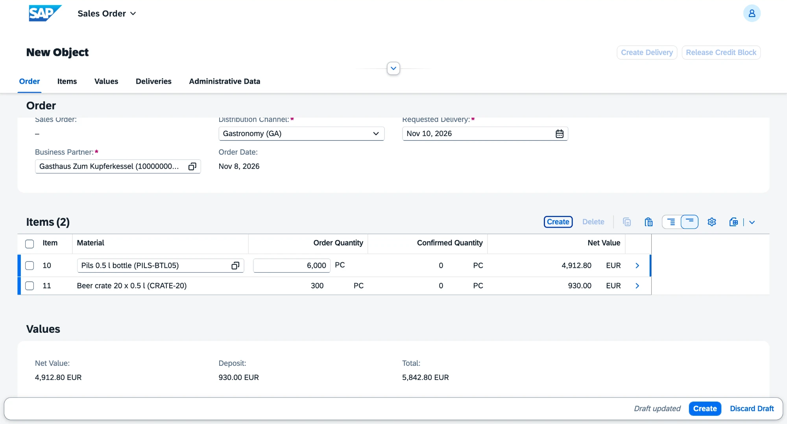
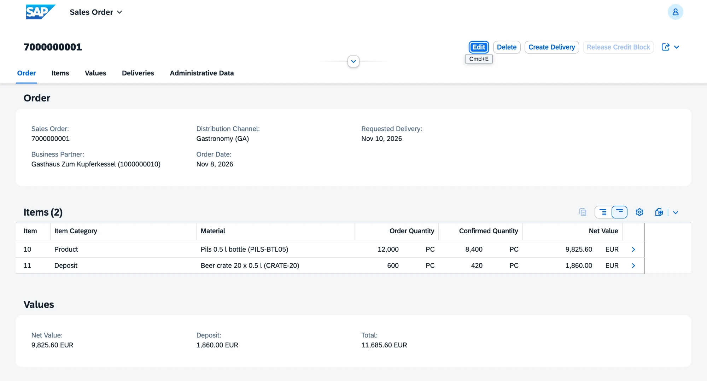
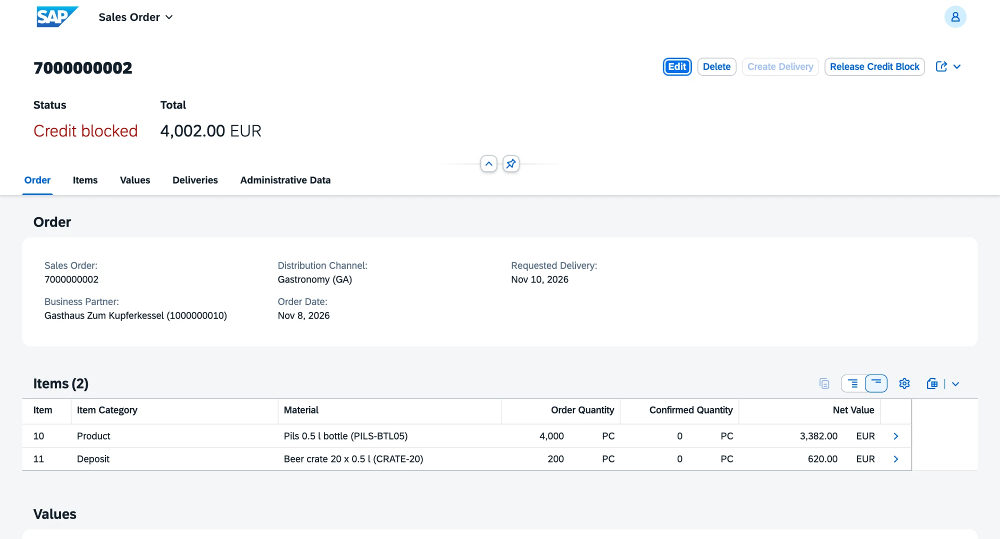
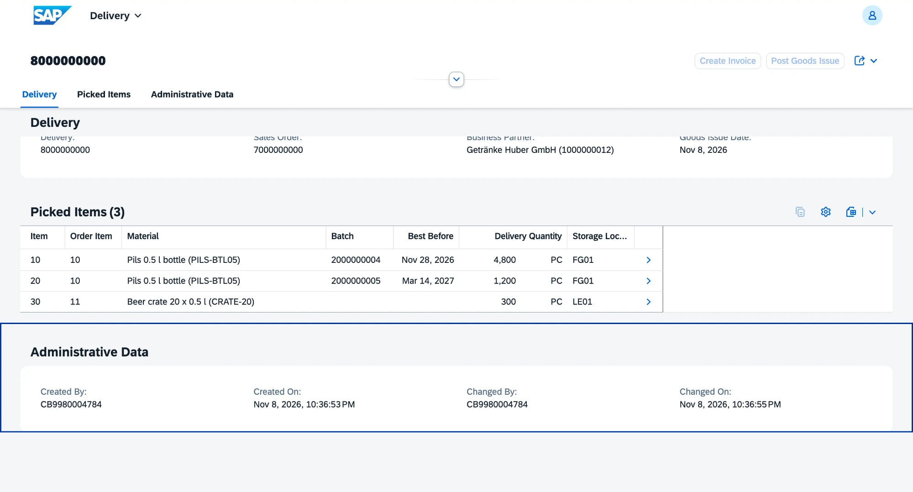
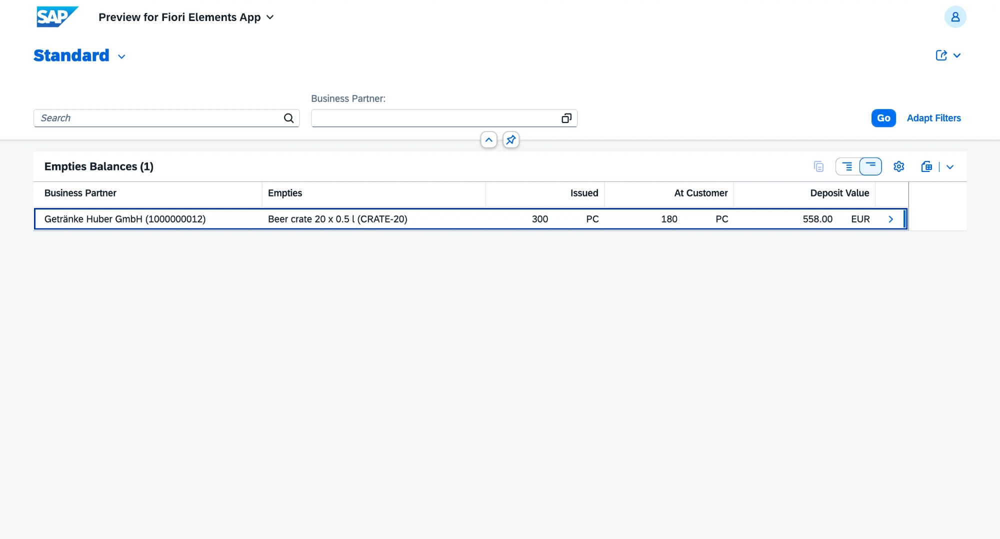

# v0.9 Sales

Sales orders with prices from conditions and a deposit line for returnable crates, availability check with partial confirmation, credit limit, delivery by FEFO, invoice and credit memo for returned empties. Requirements FR-SD-01 to FR-SD-05 and FR-IM-06.

## What is inside

| Object | Behavior |
|---|---|
| Sales order `ZVHB_R_SalesOrder` with items | customer, distribution channel and requested delivery date; number from `ZVHB_SORD` on save; status Open, Credit blocked, Delivered or Invoiced |
| Pricing | base price of the channel, discount of the highest quantity scale reached; net value, deposit and total on the order; refreshed while the draft is edited |
| Deposit item | for a material sold in returnable packaging: crates rounded up, at the deposit rate, as sub-item of the product item (00010 and 00011) |
| Availability | the confirmed quantity is limited to what is available to promise; partial confirmation with a warning |
| Credit check | on save: open orders and invoices of the customer plus this order against the credit limit; Release Credit Block lifts the block |
| Create Delivery | delivery `ZVHB_R_Delivery` with the confirmed quantities; beer split over batches by FEFO, crates from the empties store |
| Post Goods Issue | movement type 601 for beer and crates |
| Create Invoice | billing document `ZVHB_R_BillingDocument` at the prices of the order; the order becomes Invoiced |
| Return Empties | static action on the billing documents: receipt of the crates with movement type 653 and a credit memo for the deposit |
| Empties balance | `ZVHB_C_EmptiesBalance`: crates issued, returned and at the customer, with their deposit value |

Checks on the sales order:

- the customer exists, has the customer role and is not blocked;
- the distribution channel exists;
- the requested delivery date is not in the past;
- the order has at least one product item;
- each product item has an active finished product, a quantity above zero and a price in the channel.

Checks on returned empties: the quantity is above zero and not more than the customer has.

| Area | Objects |
|---|---|
| Domains | `ZVHB_SO_STATUS` (OPEN, CRBL, DLVD, BILL), `ZVHB_DLV_STATUS` (PICK, GI, BILL), `ZVHB_BILL_TYPE` (INV, CRM), `ZVHB_ITEM_CAT` (PROD, DEPO) with value helps; movement types 653 and 654 in `ZVHB_MOVEMENT_TYPE` |
| Data elements | `ZVHB_SALES_ORDER`, `ZVHB_DELIVERY`, `ZVHB_BILLING_DOC`, `ZVHB_SD_ITEM`, `ZVHB_SO_STATUS`, `ZVHB_DLV_STATUS`, `ZVHB_BILL_TYPE`, `ZVHB_ITEM_CAT` |
| Tables | `ZVHB_SOHDR`, `ZVHB_SOITM` and their draft tables, `ZVHB_DLVHDR`, `ZVHB_DLVITM`, `ZVHB_BILLHDR`, `ZVHB_BILLITM` |
| Views | `ZVHB_I_CustomerVH`, `ZVHB_I_SalesFreeStock`, `ZVHB_I_OrderDemand`, `ZVHB_I_MaterialDemand`, `ZVHB_I_AvailableToPromise`, `ZVHB_I_CreditExposureItem`, `ZVHB_I_EmptiesMovement`, `ZVHB_I_EmptiesBalance`, `ZVHB_C_EmptiesBalance` |
| Master data | material: returnable packaging and units per package, with a check that the packaging is an active empties material |
| Inventory | movement type 653 (customer return) and its reversal 654 |
| App | `ZVHB_UI_SALESORDER_O4` with sales orders, deliveries, billing documents and empties balances |
| Messages | `ZVHB_SD` 001 to 021, `ZVHB_MD` 046 and 047 |
| Demo data | `ZCL_VHB_DEMO_DATA` sells 6,000 bottles to the wholesaler (delivered, invoiced, 120 crates returned), 12,000 bottles to the inn (8,400 confirmed) and 4,000 more to the inn (credit blocked) |

## Decisions

- [ADR 11](../adr/0011-order-to-cash-documents.md) Order-to-cash: one business object per document, availability and credit in CDS

## Quality

- ABAP Unit: 23 new tests, all green.
  - 14 in `ZBP_VHB_R_SALESORDER`: scale discount and base price, deposit item and totals, partial confirmation, credit block and its release, the validations, FEFO picking and missing stock.
  - 3 in `ZBP_VHB_R_DELIVERY`: batch splits billed as one line, deposit billed separately, prorated partial delivery.
  - 3 in `ZBP_VHB_R_BILLINGDOCUMENT`: returned empties against the balance.
  - 3 new in `ZBP_VHB_R_MATERIAL`: the packaging assignment.

  The buffers of order, delivery and material and the tables and views of prices, partners, stock and open documents are replaced by test doubles. The tests of inventory stay green.
- ATC with check variant `ABAP_CLOUD_DEVELOPMENT_DEFAULT`: no errors and no warnings in `Z_VH_BREW_SD` and the changed classes of master data and inventory.
- abaplint: green on push.

## How to check

1. Run `ZCL_VHB_DEMO_DATA` with F9. The console ends with three sales orders: Invoiced, Open and Credit blocked.
2. In ADT open `Z_VH_BREW_SD`, Business Services, Service Bindings, `ZVHB_UI_SALESORDER_O4`. Select an entity set and choose Preview.
3. SalesOrders: create an order for the inn in channel Gastronomy with 6,000 bottles. Price, discount and the deposit item appear before saving.
4. SalesOrders: the order with 12,000 bottles has 8,400 confirmed; the order with 4,000 bottles is credit blocked.
5. Deliveries: the delivery of the wholesaler takes 4,800 bottles from the older batch and 1,200 from the next one, plus 300 crates.
6. EmptiesBalances: the wholesaler has 180 crates worth 558.00 EUR deposit.

## Screenshots

New order: gastronomy price with 8 % scale discount and the deposit item, while the order is still a draft.

12,000 bottles ordered, 8,400 confirmed: the rest of the free stock.

The second order of the inn goes over its credit limit of 15,000 EUR.

Delivery split over two batches by best-before date, crates from the empties store.

Crates at the customer after 300 delivered and 120 returned.

## What I learned

- Side effects on item fields refresh price and totals in the draft. The determination runs on the server, the UI only asks for the changed fields again.
- One determination can create, change and delete sibling items in local mode. Fields that only the business object may set stay read-only for the user and are filled in local mode.
- A determination on a child with the trigger delete still gets the keys of the deleted items, and they contain the key of the parent.
- Union views need the same type in every branch; a calculated amount in the second branch must be cast to the type of the first.
- Validations may not read CDS views that are built on tables of other business objects; determinations and actions may.
- Calculations that only need data are easier to test when the action reads the data and passes it to a method, instead of the method reading it itself.
